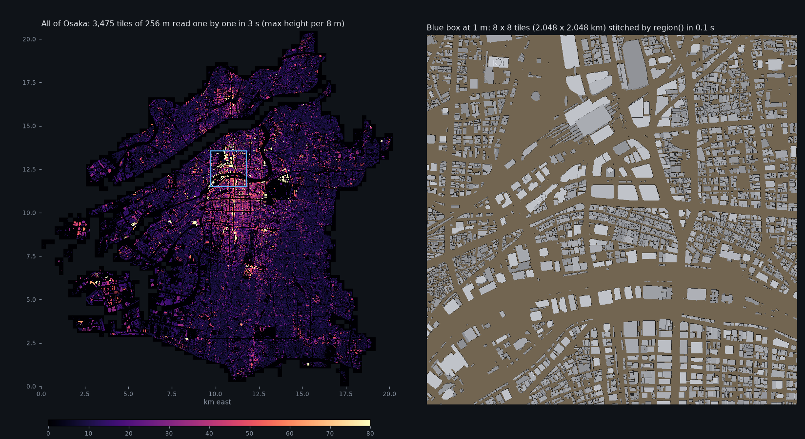
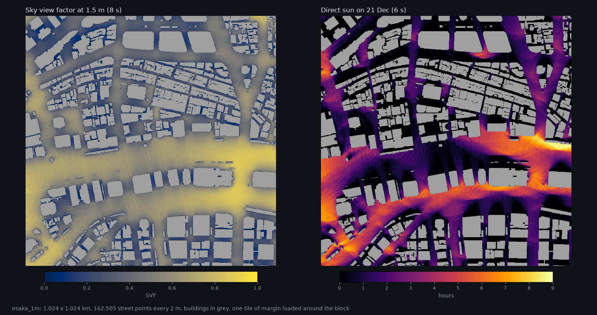
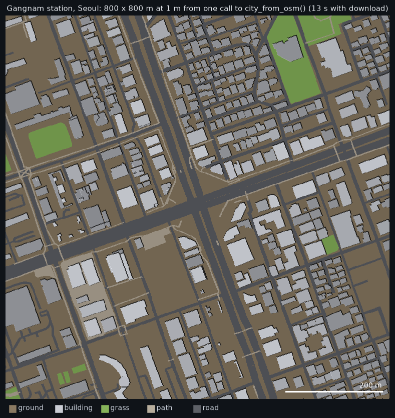

# OctreeCity

Voxel cities that stay small. OctreeCity stores a city as **columns of label
runs** (ground up to 1 m, building up to 67 m, air above, tree canopy with air
under it...). It builds **adaptive octrees** from them on demand, for any
application: storage, ray analyses, machine learning, visualization, CFD.



*All of Osaka: 556,724 buildings, 228 km² at 1 m, built in 26 s into one 37 MB file
(a dense voxel grid would be 14.6 GB).*

## Why

Dense voxel grids (as in VoxCity) grow with volume: 1 m cells over a city is
gigabytes, so people fall back to 5 m cells. City geometry is mostly vertical
walls, flat roofs and layers, so OctreeCity stores runs along z. Size then
follows the footprint outlines, not the volume.

| 20 Osaka tiles, 1 m | dense grid | octree | **columns** |
|---|---|---|---|
| zipped on disk | 662 kB | 575 kB | **228 kB** |
| in memory | 113 MB | 55 MB | **20 MB** |
| build per 256 m tile | | 17 ms | **1.2 ms** |

## What it does

| Module | |
|---|---|
| `columns` | `ColumnCity`: the storage format (CSR runs per column), any number of layers per column, exact round trip to dense grids |
| `easy` | `city_from_osm(lat, lon, size_m)`: one call, any place, data downloaded from OpenStreetMap |
| `sources` | readers: CityGML (LoD0-2, streamed), GeoJSON, OSM Overpass JSON, footprint lists |
| `builder` | `CityBuilder`: terrain, land cover (water, grass, roads...), tree canopies over air, buildings on the terrain |
| `tiles` | tiled store (one zip, random access per tile), `build_tiled` in parallel, `region()` stitching |
| `octree` | `LinearOctree`: Morton-ordered leaves, point location, 2:1 balance, refinement near surfaces, 2 bytes per leaf on disk |
| `city` | `build_city(heights, pixel_size, min_cell, max_cell)`: user-chosen min/max cell size in metres |
| `adapt` | split-and-merge adaptation to **any field** (wind, sun hours, noise, ML output) with min/max size, buffer layers, cell budget, value transfer |
| `analysis` | sky view factor, shadows, sun position, sun hours; surface or exact rays (light passes under canopies) |
| `exports` | OBJ meshes (merged faces, one material per label), 2D/3D tensors for ML |
| `foam` | CFD plugin: OpenFOAM polyMesh of the fluid cells, with hanging-node faces |
| `viz` | interactive 3D (plotly): `show(city)`, results on the street, adaptive cells on a cut |
| `render` | shaded top views and sections (images) |



## Start in one minute

```bash
git clone https://github.com/MahmoudAbdelRahman/octreecity && cd octreecity && uv sync
```

```python
from octreecity.easy import city_from_osm
from octreecity.analysis import street_points, sky_view_factor

city = city_from_osm(37.4979, 127.0276, size_m=800)   # any place: OSM buildings, land cover, trees, roads
pts, _ = street_points(city, every=2)
svf = sky_view_factor(city, pts)
```

Notebook: [notebooks/octreecity_quickstart.ipynb](notebooks/octreecity_quickstart.ipynb) (3D views, step by step).
Full docs: [quickstart](docs/quickstart.md), [3D views](docs/visualize.md), [inputs](docs/inputs.md),
[analysis](docs/analysis.md), [octrees and adaptation](docs/octree.md),
[exports](docs/exports.md), [whole cities](docs/tiles.md), [command line](docs/cli.md),
[file formats](docs/formats.md).



## Use with your own data

```python
from octreecity.sources import read_citygml
from octreecity.builder import CityBuilder
from octreecity.analysis import street_points, sky_view_factor

bld = read_citygml("buildings.gml.gz").clip(x0, y0, x0 + 1000, y0 + 1000)
b = CityBuilder(x0, y0, 1000, 1000, cell=1.0)
b.add_terrain(dem)             # raster or callable(x, y), metres
b.add_buildings(bld)
city = b.build()               # ColumnCity
city.save("city.npz")

pts, _ = street_points(city, every=2)
svf = sky_view_factor(city, pts)
tree = city.to_octree(5)       # adaptive cells, 1 m to 32 m
```

Command line:

```bash
octreecity tiles --wkb-pickle buildings.pkl.gz --cell 1 -o city.ocz
octreecity info city.ocz
octreecity svf city.ocz --region 40 46 44 50 -o svf.png
octreecity sun city.npz --lat 34.69 --lon 135.5 --tz 9 --date 2026-12-21 -o sun.png
octreecity obj city.npz -o city.obj
octreecity foam city.npz --max-cell 16 --near 8 -o case/
```

All lengths are metres, in the projected CRS of the input data.

## Status: alpha (0.1)

Works and is tested (52 tests) on Osaka (PLATEAU) and Daejeon (V-World CityGML
plus OpenStreetMap). Known gaps:

- No DEM reader yet. The KAIST demo estimates terrain from building base heights.
- The OpenFOAM export passes the package's own closedness and volume checks, but
  has not been run through OpenFOAM `checkMesh` yet. It takes about 24 s for
  1.7 M cells (binary files).
- Ray analyses: direct sun and sky visibility only (no reflections or diffuse
  light), trees opaque, grid north taken as true north.
- The tiled builder takes buildings and land cover, not yet trees or terrain.
- File formats may still change before 1.0.

## Data credits

Demo data, not included in the repository: PLATEAU (MLIT Japan) for Osaka,
V-World (Korea) for Daejeon buildings, and © OpenStreetMap contributors (ODbL)
for land cover, trees and roads in the KAIST images.

## License

MIT, see [LICENSE](LICENSE).
