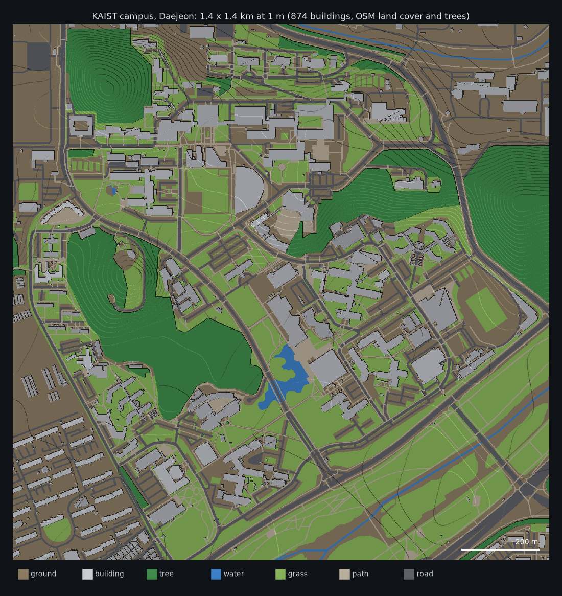

# OctreeCity

OctreeCity turns city data into a light 3D model that you can explore,
analyse and reuse for many kinds of urban questions: how much sky people see
from the street, where the winter sun reaches, how buildings shape the space
around them, and what an adaptive grid for simulation or machine learning
should look like.


## What you can do with it

- **Build a 3D city for any place** from OpenStreetMap in one line, or from
  your own data (CityGML from PLATEAU or V-World, GeoJSON, building footprints),
  with terrain, land cover, trees and buildings.
- **Look around it** in interactive 3D views in Jupyter or VS Code.
- **Ask street-level questions:** sky view factor, shadows and hours of direct
  sun, for any date and place.
- **Use adaptive cells:** small cells where detail matters (near walls, the
  ground, shadow edges or any field you care about) and large cells in open
  air, with the smallest and largest sizes set by you.
- **Work at city scale:** whole cities are stored as tiles in one file, and
  any tile can be read on its own. All of Osaka (556,724 buildings, 228 km² at
  1 m) builds in about half a minute into 37 MB.
- **Take the results elsewhere:** 3D models (OBJ) for Blender or Rhino,
  arrays for machine learning, and meshes for CFD (OpenFOAM) as an optional
  plugin.

<p align="center">
  
  
</p>

*Left: where the sun reaches the streets of downtown Osaka on the shortest day.
Right: the KAIST campus from V-World buildings and OpenStreetMap land cover.*

## Install

```bash
pip install octreecity              # core
pip install "octreecity[viz]"       # with interactive 3D views and images
pip install "octreecity[notebook]"  # with JupyterLab for the tutorial notebook
```

Python 3.10 or newer. From source:
`git clone https://github.com/MahmoudAbdelRahman/octreecity && cd octreecity && uv sync`

## Quick start

```python
from octreecity.easy import city_from_osm
from octreecity.viz import show, show_values, street_map
from octreecity.analysis import street_points, sky_view_factor

city = city_from_osm(36.3700, 127.3625, size_m=1000)   # KAIST, Daejeon: any lat, lon works
show(city)                                              # interactive 3D

pts, where = street_points(city, every=4)               # 1.5 m above the ground
svf = sky_view_factor(city, pts)
show_values(city, street_map(city, where, svf, 4), "Sky view factor", colorscale="Cividis")
```

The tutorial notebook goes through it step by step, with a 3D view after each
step: [notebooks/octreecity_quickstart.ipynb](notebooks/octreecity_quickstart.ipynb).
Run it with `./demo.sh` (see [running the notebook](docs/how-to/run-the-notebook.md)).

## Using your own data

```python
from octreecity.sources import read_citygml
from octreecity.builder import CityBuilder

buildings = read_citygml("buildings.gml.gz").clip(x0, y0, x0 + 1000, y0 + 1000)
b = CityBuilder(x0, y0, width=1000, depth=1000, cell=1.0)   # metres, projected CRS
b.add_terrain(dem)                                           # raster or function of (x, y)
b.add_buildings(buildings)
city = b.build()
city.save("city.npz")
```

From the command line:

```bash
octreecity build --citygml buildings.gml.gz --cell 1 -o city.npz
octreecity svf city.npz -o svf.png
octreecity sun city.npz --lat 34.69 --lon 135.5 --tz 9 --date 2026-12-21 -o sun.png
octreecity obj city.npz -o city.obj
```

## How it works

A city is mostly vertical walls, flat roofs and layers. OctreeCity uses two
representations of the same voxels:

1. **Columns (for storage).** Each vertical column keeps a short list of runs:
   *ground up to 1 m, building up to 67 m, air above*. A column can hold any
   number of layers, such as a tree canopy with air beneath it, or a bridge.
   The model's size then follows the outlines of buildings rather than their
   volume, so storing 1 m detail for a whole city becomes practical.
2. **Octrees (for computation).** When an application needs cells of varying
   size, an octree is built from the columns: cubes of 1, 2, 4 ... m that stay
   small where detail matters. They can follow geometry (near surfaces) or any
   field you provide (`adapt()`, the split-and-merge idea used by adaptive
   CFD codes).

Every cell keeps a label (ground, building, tree, water, grass, road ... or
your own classes), and any dense voxel grid can be converted in and out
exactly.


*Adaptive cells on a simulated wind field: start coarse, split where neighbouring
values differ, merge where they agree, repeat.*

## Documentation

The [documentation](docs/index.md) is organised by what you want to do:

- **Tutorials:** [quickstart](docs/tutorials/quickstart.md) and the [notebook](notebooks/octreecity_quickstart.ipynb)
- **How-to guides:** [your own data](docs/how-to/own-data.md), [3D views](docs/how-to/3d-views.md),
  [sky view and sun](docs/how-to/sky-and-sun.md), [whole cities](docs/how-to/whole-cities.md),
  [export](docs/how-to/export.md), [running the notebook](docs/how-to/run-the-notebook.md)
- **Explanation:** [how it works](docs/explanation/how-it-works.md), [adaptive cells](docs/explanation/adaptive-cells.md)
- **Reference:** [modules](docs/reference/api.md), [command line](docs/reference/cli.md), [file formats](docs/reference/file-formats.md)

## Related work

OctreeCity builds on ideas from a lively field and is meant to work alongside
existing tools:

- [VoxCity](https://github.com/kunifujiwara/VoxCity) generates grid-based 3D
  city models from global open data and runs urban simulations on them. Any
  dense voxel grid, such as a VoxCity model with its classes mapped to
  OctreeCity labels, can be loaded with `ColumnCity.from_dense`.
- [OpenVDB](https://www.openvdb.org/) and sparse voxel octrees in computer
  graphics, for sparse and hierarchical volumes.
- Adaptive mesh refinement in CFD (for example OpenFOAM and Basilisk), which
  inspired `adapt()`.
- Open city data such as [PLATEAU](https://www.mlit.go.jp/plateau/),
  [V-World](https://www.vworld.kr/) and
  [OpenStreetMap](https://www.openstreetmap.org/).

## Status

Version 0.1 (alpha). It is tested (56 tests, Python 3.10 to 3.13) with Osaka
(PLATEAU) and Daejeon (V-World and OpenStreetMap). File formats may still
change before 1.0. Known gaps:

- No elevation model (DEM) reader yet. `city_from_osm` uses flat terrain.
- The OpenFOAM export passes the package's own mesh checks but has not yet
  been verified with OpenFOAM's `checkMesh`.
- Ray analyses cover direct sun and sky visibility (no reflections or diffuse
  light), and trees are treated as opaque.
- The parallel tiled builder handles buildings and land cover, not yet trees
  or terrain.

Questions, ideas and issues are welcome on
[GitHub](https://github.com/MahmoudAbdelRahman/octreecity/issues).

## Data credits

Images in this README use PLATEAU (MLIT, Japan) for Osaka, V-World (Korea) for
Daejeon buildings, and © OpenStreetMap contributors (ODbL) for land cover,
trees and roads. The data itself is not included in the repository.

## License

MIT, see [LICENSE](LICENSE).
