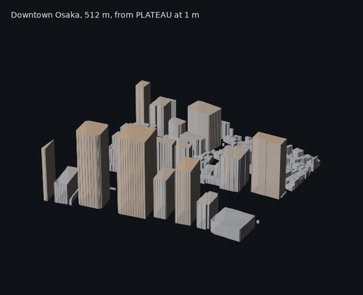
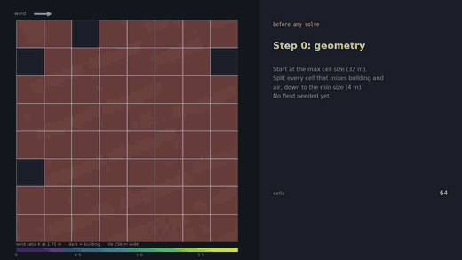
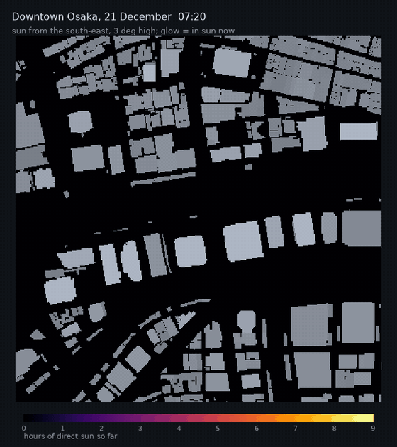
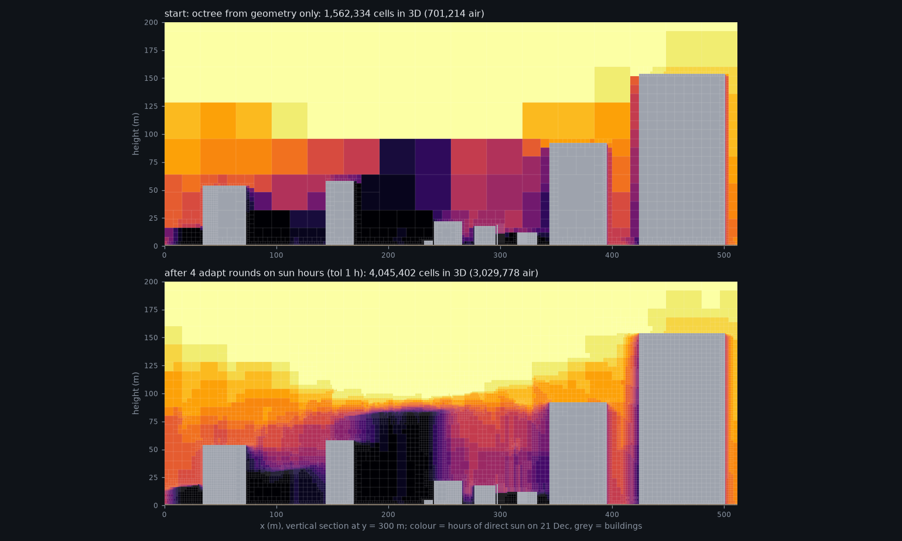

# OctreeCity

**A compact, adaptive 3D model of cities, for simulation, analysis and
machine learning.**

OctreeCity turns open city data into a voxel model that stays light enough for
whole cities at 1 m resolution, adapts its cell sizes to what matters, and keeps
every cell labelled (ground, building, tree, water, road or your own classes).
It is meant as a common foundation: build the city once, then use the same
model to store it, run simulations on it, analyse it, train models on it and
show it.



## What it is for

**City-scale 3D data.** Whole cities are stored as tiles in one file, and any
tile can be read on its own. All of Osaka (556,724 buildings, 228 km² at 1 m)
builds in about half a minute into 37 MB. A column of cells can hold any number
of layers, such as tree canopies with air beneath them, bridges or overhangs,
and the model converts to and from ordinary voxel grids exactly.

**Simulation grids.** Adaptive octree cells stay small where detail matters
and grow in open air. They can follow geometry (walls, the ground) or any field
you give them (wind, heat, sun, pollutant concentration, a model's output),
with the smallest and largest cell sizes set by you. Values move between
refined meshes, and an optional plugin writes OpenFOAM meshes for CFD.



**Environmental analysis in 3D.** Sky view factor, shadows and hours of direct
sun for any place and date: at street level, on roofs, or at any point in the
air. Light can pass through the space under tree canopies and bridges.

<p align="center">
  
</p>

*Downtown Osaka on the shortest day: the glow shows where the sun is at that
moment, and the heatmap adds up the hours of direct sun.*

**Machine learning.** Labelled cells become 2D or 3D arrays for image and
volume models, and adaptive cells with their neighbour links form a natural
graph. Use them as inputs for surrogate models of wind, heat or daylight, or to
compare places.

**Visualisation and sharing.** Interactive 3D views in Jupyter and VS Code, 3D
models (OBJ) for Blender, Rhino or Unity, shaded maps and sections.

**Any data source.** Build a city for any place from OpenStreetMap in one
line, or from your own data: CityGML (PLATEAU, V-World and others), GeoJSON,
building footprints, terrain rasters, land cover and trees.



*Adaptive cells following a 3D field: hours of winter sun in the air above
downtown Osaka. Cells refine along the edges of shadow volumes and stay large
in uniform sun or shade.*

## Install

```bash
pip install octreecity              # core
pip install "octreecity[viz]"       # with interactive 3D views and images
pip install "octreecity[notebook]"  # with JupyterLab for the tutorial notebook
```

Python 3.10 or newer. From source:
`git clone https://github.com/MahmoudAbdelRahman/octreecity && cd octreecity && uv sync`

## Quick start

```python
from octreecity.easy import city_from_osm
from octreecity.viz import show, show_values, street_map
from octreecity.analysis import street_points, sky_view_factor

city = city_from_osm(36.3700, 127.3625, size_m=1000)   # KAIST, Daejeon: any lat, lon works
show(city)                                              # interactive 3D

pts, where = street_points(city, every=4)               # 1.5 m above the ground
svf = sky_view_factor(city, pts)
show_values(city, street_map(city, where, svf, 4), "Sky view factor", colorscale="Cividis")
```

The tutorial notebook goes through it step by step, with a 3D view after each
step: [notebooks/octreecity_quickstart.ipynb](notebooks/octreecity_quickstart.ipynb).
Run it with `./demo.sh` (see [running the notebook](docs/how-to/run-the-notebook.md)).

## Using your own data

```python
from octreecity.sources import read_citygml
from octreecity.builder import CityBuilder

buildings = read_citygml("buildings.gml.gz").clip(x0, y0, x0 + 1000, y0 + 1000)
b = CityBuilder(x0, y0, width=1000, depth=1000, cell=1.0)   # metres, projected CRS
b.add_terrain(dem)                                           # raster or function of (x, y)
b.add_buildings(buildings)
city = b.build()
city.save("city.npz")
```

From the command line:

```bash
octreecity build --citygml buildings.gml.gz --cell 1 -o city.npz
octreecity svf city.npz -o svf.png
octreecity sun city.npz --lat 34.69 --lon 135.5 --tz 9 --date 2026-12-21 -o sun.png
octreecity obj city.npz -o city.obj
```

## How it works

A city is mostly vertical walls, flat roofs and layers. OctreeCity uses two
representations of the same voxels:

1. **Columns (for storage).** Each vertical column keeps a short list of runs:
   *ground up to 1 m, building up to 67 m, air above*. A column can hold any
   number of layers, such as a tree canopy with air beneath it, or a bridge.
   The model's size then follows the outlines of buildings rather than their
   volume, so storing 1 m detail for a whole city becomes practical.
2. **Octrees (for computation).** When an application needs cells of varying
   size, an octree is built from the columns: cubes of 1, 2, 4 ... m that stay
   small where detail matters. They can follow geometry (near surfaces) or any
   field you provide (`adapt()`, the split-and-merge idea used by adaptive
   CFD codes).

Every cell keeps a label (ground, building, tree, water, grass, road ... or
your own classes), and any dense voxel grid can be converted in and out
exactly.

*The animation under "Simulation grids" shows the idea on a simulated wind
field: start coarse, split where neighbouring values differ, merge where they
agree, repeat.*

## Documentation

The [documentation](docs/index.md) is organised by what you want to do:

- **Tutorials:** [quickstart](docs/tutorials/quickstart.md) and the [notebook](notebooks/octreecity_quickstart.ipynb)
- **How-to guides:** [your own data](docs/how-to/own-data.md), [3D views](docs/how-to/3d-views.md),
  [sky view and sun](docs/how-to/sky-and-sun.md), [whole cities](docs/how-to/whole-cities.md),
  [export](docs/how-to/export.md), [running the notebook](docs/how-to/run-the-notebook.md)
- **Explanation:** [how it works](docs/explanation/how-it-works.md), [adaptive cells](docs/explanation/adaptive-cells.md)
- **Reference:** [modules](docs/reference/api.md), [command line](docs/reference/cli.md), [file formats](docs/reference/file-formats.md)

## Related work

OctreeCity builds on ideas from a lively field and is meant to work alongside
existing tools:

- [VoxCity](https://github.com/kunifujiwara/VoxCity) generates grid-based 3D
  city models from global open data and runs urban simulations on them. Any
  dense voxel grid, such as a VoxCity model with its classes mapped to
  OctreeCity labels, can be loaded with `ColumnCity.from_dense`.
- [OpenVDB](https://www.openvdb.org/) and sparse voxel octrees in computer
  graphics, for sparse and hierarchical volumes.
- Adaptive mesh refinement in CFD (for example OpenFOAM and Basilisk), which
  inspired `adapt()`.
- Open city data such as [PLATEAU](https://www.mlit.go.jp/plateau/),
  [V-World](https://www.vworld.kr/) and
  [OpenStreetMap](https://www.openstreetmap.org/).

## Status

Version 0.1 (alpha). It is tested (56 tests, Python 3.10 to 3.13) with Osaka
(PLATEAU) and Daejeon (V-World and OpenStreetMap). File formats may still
change before 1.0. Known gaps:

- No elevation model (DEM) reader yet. `city_from_osm` uses flat terrain.
- The OpenFOAM export passes the package's own mesh checks but has not yet
  been verified with OpenFOAM's `checkMesh`.
- Ray analyses cover direct sun and sky visibility (no reflections or diffuse
  light), and trees are treated as opaque.
- The parallel tiled builder handles buildings and land cover, not yet trees
  or terrain.

Questions, ideas and issues are welcome on
[GitHub](https://github.com/MahmoudAbdelRahman/octreecity/issues).

## Data credits

Images in this README use PLATEAU (MLIT, Japan) for Osaka, V-World (Korea) for
Daejeon buildings, and © OpenStreetMap contributors (ODbL) for land cover,
trees and roads. The data itself is not included in the repository.

## License

MIT, see [LICENSE](LICENSE).
